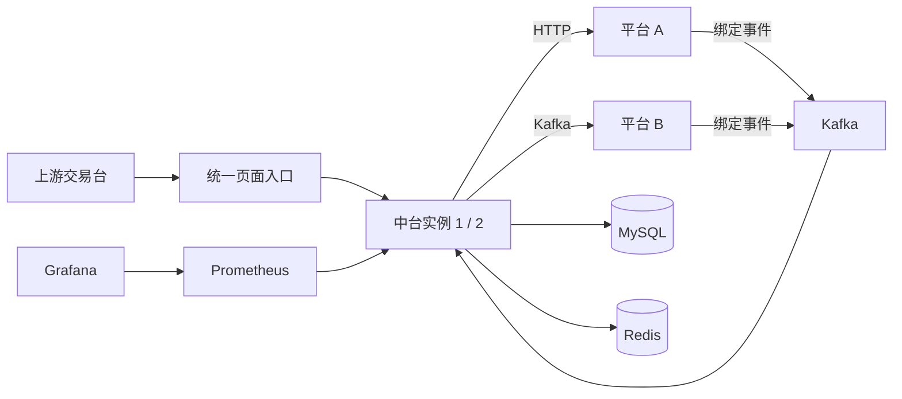

# PartnerHub

面向外部合作平台的成交消息中台 Demo：上游输入成交，中台按客户绑定路由，向平台 A 发 HTTP 通知、向平台 B 发 Kafka 消息，并提供归档、有限恢复、人工重试和运维查询。

包含四个独立控制台、双中台实例、Prometheus／Grafana 看板，以及按 Trace ID 查询的单消息耗时图。所有演示页面默认只在本机开放。



## 选择启动方式

| | Docker 一键运行（推荐演示） | 本地源码运行（推荐开发） |
|---|---|---|
| 本机工具 | Git、Docker Engine／Desktop、Compose v2；Python 3.9+用于便捷命令 | Git、Go 1.27.2+、Python 3.9+ |
| 应用 | Docker 内从源码构建，自动启动两个中台和三个 Mock | 本机编译，启动一个中台、三个 Mock及本机页面网关 |
| MySQL／Redis／Kafka | Compose 自动创建 | 自行安装或使用已有开发实例 |
| 观测服务 | 自动启动 Prometheus／Grafana | 按需自行配置，未配置时指标明确显示不可用 |
| 配置文件 | `.env` | `.env.native` |

Docker 路径适用于 Linux、macOS、Windows 的 **Linux 容器环境**，不要求宿主安装 Go、Node 或 Make。镜像架构由 Docker 决定，未固定为 Apple Silicon；Windows 请启用 Docker Desktop 的 WSL2／Linux containers。建议为 Docker 分配至少4核、8GB内存及15GB空闲磁盘。首次需要联网下载镜像与Go依赖。

## 方式一：Docker 一键运行

```sh
git clone https://github.com/BestKurumi/PartnerHub.git
cd PartnerHub
python3 scripts/demo.py up
```

Windows PowerShell 将 `python3` 替换成 `py -3`，例如 `py -3 scripts/demo.py up`。

命令会保留已有 `.env`；第一次则从模板生成独立随机密码和令牌，然后校验 Docker、构建应用镜像、执行数据库迁移并等待服务健康。构建发生在固定版本Go镜像内，不使用仓库外的本机文件。首次启动可能需要数分钟。

只想使用Docker命令、没有Python时，可手动复制 `.env.example` 为 `.env`，修改其中的密码和令牌，再执行：

```sh
docker compose --env-file .env config --quiet
docker compose --env-file .env up -d --build --wait --wait-timeout 300
```

macOS／Linux用 `cp .env.example .env`；PowerShell用 `Copy-Item .env.example .env`。不要覆盖已有配置。模板值仅用于本机演示，便捷脚本会替换为随机值。

默认访问地址如下；修改端口后用 `python3 scripts/demo.py urls` 查看实际地址。

| 页面 | 地址 |
|---|---|
| 中台运维 | http://127.0.0.1:8080/hub/ |
| 上游交易台 | http://127.0.0.1:8080/mock/upstream/ |
| 平台 A | http://127.0.0.1:8080/mock/p1/ |
| 平台 B | http://127.0.0.1:8080/mock/p2/ |
| Grafana | http://127.0.0.1:3000/d/hub-overview |
| Prometheus | http://127.0.0.1:9090 |

四个平台页面人工输入 `.env` 中的 `DEMO_TOKEN`。Grafana账号为 `GRAFANA_USER`（默认admin），密码为 `GRAFANA_PASSWORD`。`HUB_OPS_TOKEN`用于两个中台实例内部诊断，与浏览器令牌用途不同，无需填写到页面。凭据仅保存在本地配置，不包含在Git仓库中。

```sh
python3 scripts/demo.py status    # 查看服务状态
python3 scripts/demo.py logs      # 跟踪日志，Ctrl-C退出日志查看
python3 scripts/demo.py down      # 停止容器，保留数据卷
python3 scripts/demo.py up        # 重新构建启动，保留数据
```

应用镜像也可以单独打包给另一台**相同CPU架构**的Docker环境：

```sh
docker compose build hub-1
docker image save -o partner-hub-demo.tar partner-hub/mvp:local
# 接收方：clone本仓库、生成.env后加载；中间件镜像仍需拉取
docker image load -i partner-hub-demo.tar
docker compose up -d --no-build --wait --wait-timeout 300
```

上例假设 `.env` 的 `HUB_IMAGE` 保持默认；修改过镜像名时，使用对应名称。跨amd64／arm64请在目标机器重新构建；此tar包只包含应用，不包含数据库数据或整套离线中间件镜像。

## 方式二：自定义依赖，本地源码运行

准备 Go 1.27.2+、Python 3.9+，以及可连接的 **MySQL 8.4、Redis 7、Kafka 3.7+**。该模式不要求Docker，不会自动安装、停止或清空你的依赖。

1. 生成配置文件：

   ```sh
   python3 scripts/demo.py native-init
   ```

2. 编辑 `.env.native`，填写已有MySQL的地址／root密码、Redis地址／密码、Kafka Broker地址。其余演示账号密码、令牌已自动生成，通常无需修改。

3. 启动：

   ```sh
   python3 scripts/demo.py native-up
   ```

启动会由Go根据 `go.mod`／`go.sum` 自动下载依赖，初始化数据库和Kafka Topic，编译并启动四个平台。**不用手工拼DSN、执行SQL或分别启动多个进程**。想提前下载Go依赖时，也可先运行 `go mod download`。

本地统一入口为 **http://127.0.0.1:28080/hub/**，其余页面使用相同端口的 `/mock/upstream/`、`/mock/p1/`、`/mock/p2/`。页面输入 `.env.native` 的 `DEMO_TOKEN`。Ctrl-C停止本次应用；外部依赖及数据保留，日志在 `.local/native-logs/`。

已有依赖需要满足以下条件：MySQL root有创建schema与账号的权限；Redis启用AOF、正数maxmemory（建议256MB）和noeviction策略；Kafka向本机公布可访问的 `advertised.listeners`，允许创建演示Topic。启动只创建缺失对象、执行幂等迁移，不删除已有数据或覆盖已有账号密码。已有 `hub`／`mock_p1`／`mock_p2` 账号时，配置其对应密码。

配置为单行 `KEY=value`，等号后按原文读取，不加引号、不执行Shell展开；已有root／Redis密码可含特殊字符。DSN由地址与应用密码自动派生；应用密码建议用字母数字。观测服务可选，不配Prometheus时指标显示未采集。高级端口与独立迁移说明见[开发说明](docs/development.md)。

## 第一次演示：从绑定到消息耗时图

1. 打开平台A“绑定管理”，填写客户号 `000123` 和UID `demo-a-001`，发布绑定事件，等待权威结果“已生效”。
2. 在平台B用相同客户号和UID `demo-b-001` 完成绑定。`PUBLISHED`仅表示Broker接收，不能代替绑定生效。
3. 打开上游交易台，用 `000123` 生成**1条**新成交，保存返回的msgId／traceId；结果不明确时查询原标识，不重复提交。
4. 在中台“消息记录”核对平台结果；到“消息全链路”按Trace ID查询，明确选择消息，查看并发投递耗时图，点击色条查看起止时间、结果和固定UID。
5. 在平台A／B消息中心核对各自的实际接收。平台B投递成功只代表Broker确认，消费落库是独立事实。
6. 在运行总览和Grafana查看速率、依赖健康、恢复任务和历史趋势。首次采集可能需等待约30秒；无流量时速率为0，没有耗时样本时P99为空。

耗时图基于已存的事件及投递起止时间，能显示重试和尝试间隔；未采集的内部步骤、外部平台内部处理不会补造。Trace ID可能重复，同一标识的多条消息分别查看。

## 数据保留与常见问题

- 正常 `down`／`up`、容器重启均保留命名卷中的消息、绑定和平台实收；本机进程诊断日志可能随重启清空。
- 不要使用 `docker compose down -v`、删除Docker卷或删除容器虚拟机来处理启动失败，它们会丢失数据。更换 `COMPOSE_PROJECT_NAME` 会使用另一套卷；已有数据库不要随意重生成密码。
- 端口占用：修改对应配置后重新启动。Docker默认使用8080、18081～18083、3306、6379、29092、9090、3000；子网冲突时修改 `DEMO_SUBNET`。
- 镜像或Go依赖下载失败：检查Docker代理／镜像源和网络；Go官方代理不可达时，可在 `.env` 设置 `GO_MODULE_PROXY=https://goproxy.cn,direct` 后重试；不会自动降级为本机旧二进制。`make build-local-image`是需要本机Go的备用构建，按Docker服务端架构编译，详见[开发说明](docs/development.md)。
- Kafka就绪较慢或OOM：确认Docker内存预算、磁盘和 `python3 scripts/demo.py logs`。`migrate`／`kafka-init`等一次性任务正常完成后显示Exited(0)，不是故障。
- 自定义环境的Kafka必须向本机公布可访问的 `advertised.listeners`；生产TLS／SASL接入不是本Demo默认配置。
- 本仓库提供可重复演示的源码与配置，不附带作者本机历史数据库、令牌、截图报告或开发工具缓存；新clone后从空数据开始，按上面的步骤生成演示数据。

## 项目结构与开发

```text
cmd/       hub、mock、migrate、healthprobe和本地gateway入口
internal/  接入、绑定、适配器、归档恢复、查询与观测
web/       四个控制台及共享原生HTML/CSS/JS
deploy/    Compose依赖配置、迁移、Nginx和Grafana看板
config/    本地源码模式配置模板
scripts/   跨系统启动入口和回归检查
tests/     单元之外的集成、E2E及负载测试
```

```sh
go test ./... -count=1
go test -race ./... -count=1
go vet ./...
python3 -m unittest discover -s scripts -p demo_test.py
```

浏览器与集成测试环境见[开发说明](docs/development.md)；架构和语义见[架构说明](docs/architecture.md)，指标口径见[可观测说明](docs/observability.md)。已执行检查及未验证范围见[验收摘要](docs/acceptance.md)；历史提案、完整技术设计和架构图见[OpenSpec 变更归档](docs/openspec/README.md)。
