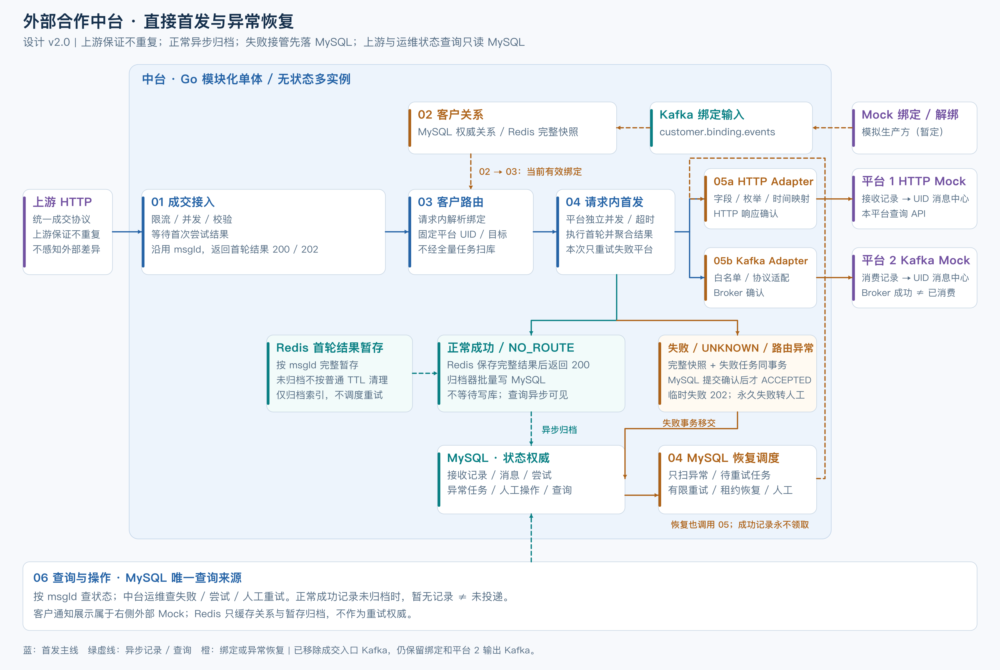
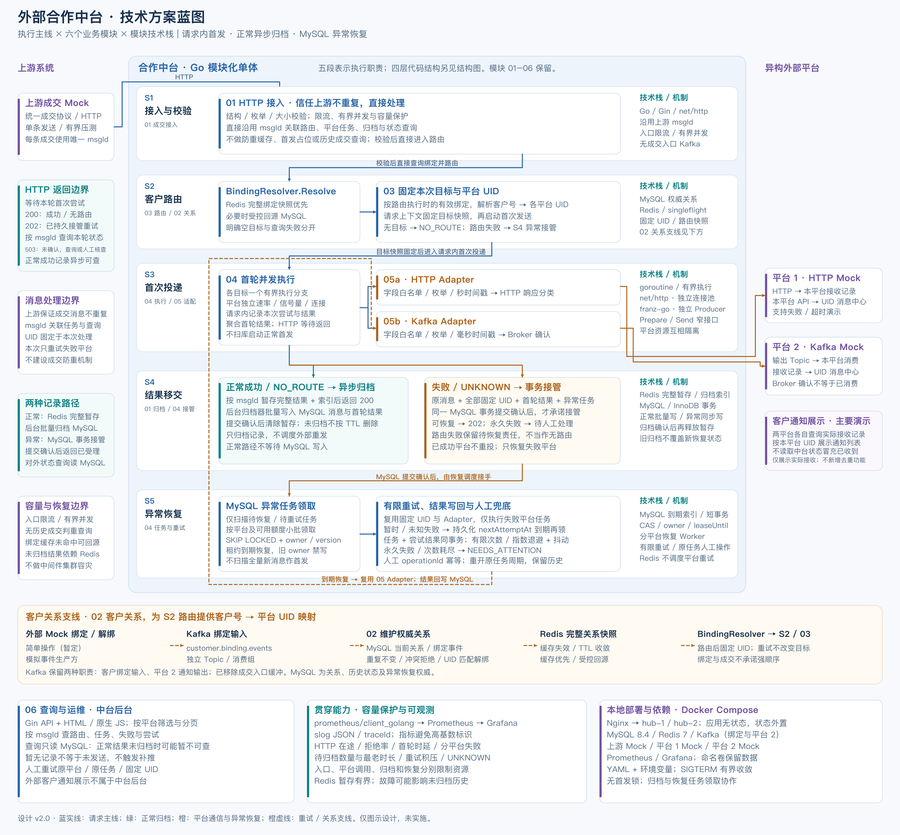
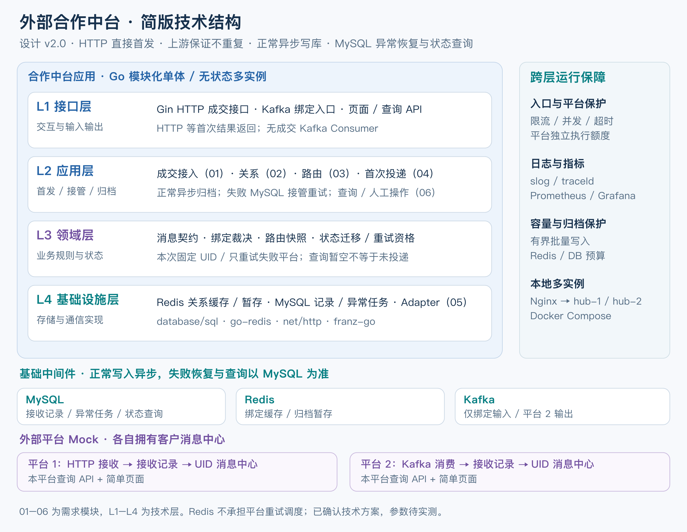
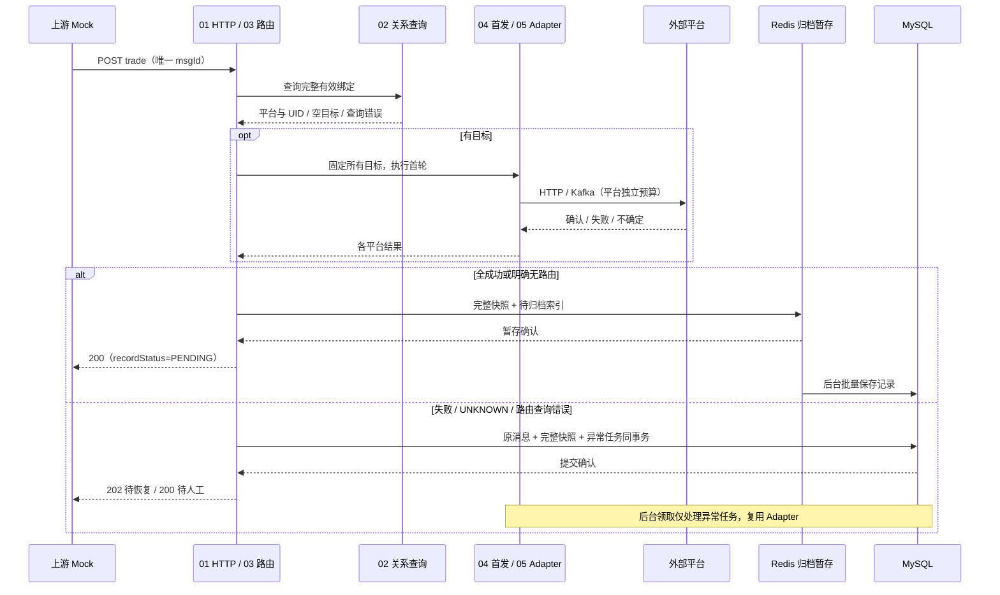
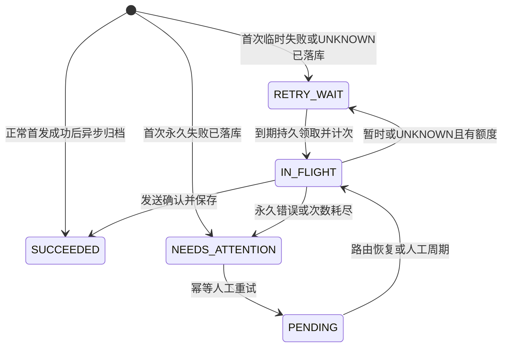

# 外部合作中台 · 技术方案设计

> 版本：v2.0（2026-10-21，用户已确认）。沿用已认可四图结构，完整方案采用 v2.0-c5。
> 依据：[权威协议](../../../../实习项目文档-陈开鑫.md)、[需求分析 v1.9](../../../../外部合作中台-MVP需求分析.md)、[技术选型 v1.5](../../../../外部合作中台-技术选型调研.md)。协议字段、枚举和外发限制以实习项目文档为最高依据。
> 范围：仅技术方案及文档图示，不开展应用开发或运行配置修改。数值是可配置初值，尚未通过集成或压测验证。

## 1. 目标与核心决策

用户已与导师确认：本 Demo 假设上游中台保证成交消息不重复，每条 msgId 对应一条成交输入。合作中台信任该前提，只做基础校验、限流、客户路由和平台投递，不建设成交业务防重。重复输入及相同 ID 不同内容的处置不属于本版设计与验收；不引入缓存判重、历史查重、首发锁或内容冲突比较。

直接沿用上游 msgId 关联消息、平台任务、日志和状态查询，不再增加独立接收编号或一条消息多次提交记录。数据库以 msgId 标识消息、以 (msgId,platformId) 约束平台任务，方便内部归档/事务重放保持记录一致；该约束不参与首次发送前的判重或资格判断。

主链路：HTTP 校验限流 → 查询绑定路由 → Adapter 请求内首次投递 → 返回本轮结果。正常成功/NO_ROUTE：Redis 暂存完整归档记录后返回 200，后台批量写 MySQL；失败/UNKNOWN/路由异常：MySQL 事务接管后返回已受理。MySQL 是异常恢复与状态查询权威。Redis 仅用于绑定缓存和正常结果归档暂存，不保存防重结果、不配置防重 TTL。

保留六模块、异构适配、路由时绑定与固定 UID、只重试失败平台、有限重试/人工兜底、无成交入口 Kafka、应用多实例及单节点中间件范围。正常 NO_ROUTE 不因后续绑定补推。上游输入不重复不等于外发恰好一次：外部已收到但确认超时、恢复 Worker 退出等情况下，有限重试仍可能重复送达；本 Demo 接受此边界，不新增中台或下游业务去重工程。

正常发送前不查询历史成交、不写入成交数据库；绑定缓存未命中仍可能受控查询 MySQL。正常记录最终仍写库，高失败率仍增加同步接管压力。

## 2. 总体架构与六模块映射

### 2.1 总体链路



[高清 PNG](./assets/architecture-flow.png) · [SVG](./assets/architecture-flow.svg)

### 2.2 执行全景



[高清 PNG](./assets/technical-blueprint.png) · [SVG](./assets/technical-blueprint.svg)

### 2.3 技术结构



[简版 SVG](./assets/technical-structure-simple.svg) · [六模块×四层详细版 PNG](./assets/technical-structure.png) · [详细版 SVG](./assets/technical-structure.svg)

四层仍为 L1 接口、L2 应用、L3 领域、L4 基础设施；六模块是业务组织维度，可以跨层。定时扫描是后台触发入口，不代表公开 API。05 具体 Adapter 为基础设施实现；规则和应用通过窄接口调用技术能力。Redis/MySQL/Kafka 是外置中间件，不在 Go 进程内。日志、配置、指标、容量及生命周期跨层支撑。外部 Mock 不属于中台六模块或四层。

| 模块 | 新版组成及数据责任 | 与旧设计差异 |
|---|---|---|
| 01 成交接入 | HTTP 校验/门控、沿用 msgId、调用首发、结果响应与正常归档 | 信任上游不重复；无入口 Kafka、首发锁或历史判重 |
| 02 客户关系 | 绑定 Kafka Consumer、MySQL 当前关系/事件、Redis 完整绑定快照与受控回源 | 语义保留；绑定 Kafka 不是成交入口 |
| 03 客户路由 | 请求内查询绑定并固定所有 UID；异常路由记录及 MySQL 到期恢复 | 正常路由不扫库、不先建数据库任务；仅异常路由进入恢复 |
| 04 投递任务 | 请求内首发、首次结果聚合、失败可靠移交、MySQL 恢复调度/Worker/租约/人工重试 | 不扫描所有新成交首发；成功记录存在任务表也不可被调度 |
| 05 平台适配 | Prepare/Send、字段枚举格式、HTTP/Kafka 传输和错误解释 | 白名单及平台成功边界保留；不直接修改 Redis/数据库任务 |
| 06 查询与操作 | MySQL 状态/失败/尝试查询、人工命令、运维页 | 上游与运维查询只读 MySQL；不回退 Redis 作权威，不承担外部消息中心 |

## 3. 技术栈、接口与代码边界

Go/Gin 模块化单体，同一程序支持 hub-1/hub-2；MySQL 8.4/InnoDB、database/sql + go-sql-driver/mysql；Redis 7、go-redis/v9；franz-go（kgo/kadm）仅用于绑定消费和平台 2 输出；HTML/原生 JS、slog JSON、prometheus/client_golang、Prometheus/Grafana、Nginx/Docker Compose。具体库版本在实施时锁定验证，本次不安装依赖。

包建议保留 cmd/hub、cmd/mock 和 internal/{ingress,binding,routing,delivery,adapter,query,infra,config}；新增 archive 仅是 infra 的内部归档组件，不是第七业务模块。显式 SQL 和窄接口避免 ORM 隐式保存、Gin/Kafka 类型渗入领域。ID 按字符串、时间 UTC 存储/Asia/Shanghai 解析交易时间；精确数字用 json.Number/十进制规范化，不经 float64。

| 接口 | 契约 |
|---|---|
| BindingResolver.Resolve | 完整目标快照/明确空结果/查询错误；不把缓存缺键当无绑定 |
| FirstDelivery.Execute | 请求预算内固定目标并首次尝试；平台独立额度，网络调用不持有 DB 事务 |
| ResultArchive.Stage/Flush | 按 msgId 暂存、批量归档；确认后删除暂存，不调用 Adapter |
| RecoveryRepository.Handoff | 原消息、首轮快照及异常任务同事务移交；同一消息的内部事务重试不重建任务 |
| RecoveryTaskSource.ClaimDue | 只领取 MySQL 异常任务；按平台与资源预算小批领取 |
| Adapter.Prepare/Send | 白名单 DTO 与统一结果；不负责中台历史判重或修改任务 SQL |
| RecoveryState.Complete/Recover | MySQL owner/version/租约控制同一个恢复任务；尝试与状态同事务 |
| RetryCommand.Execute | 原任务新周期，operationId 防止同一人工命令被反复执行；查询不触发发送 |

### 3.1 模块调用契约

四层是代码依赖视角，六模块是职责组织；采用同一 Go 程序内的直接函数调用，不为模块 01–06 再建内部 HTTP/MQ 链路。接口层解析外部数据，应用层编排模块与事务，领域层表达规则，基础设施实现关系查询、归档、数据库与 Adapter。

| 模块 | 输入 / 主要用例 | 输出与责任终点 | 异常交给谁 |
|---|---|---|---|
| 01 成交接入 | 合法 TradeEvent + 请求预算；调用 ProcessTrade | 聚合首轮结果并完成正常 Stage 或异常 Handoff，再构造 HTTP 响应 | 入口参数/过载直接拒绝；保存结果或接管不明返回 UNCONFIRMED |
| 02 客户关系 | BindingEvent；ApplyBindingEvent / ResolveBindings | 事件与当前关系同事务；提供完整有效关系快照 | DB 故障不提交 Kafka 位点，业务冲突保存结果后完成事件 |
| 03 客户路由 | TradeEvent.clientId；ResolveTargets | 固定 RouteSnapshot，含全部目标平台/UID、resolvedAt；或明确 NO_ROUTE | 查询失败与空关系分开，由 01 持久移交路由异常 |
| 04 投递任务 | TradeEvent + RouteSnapshot；ExecuteFirst / RecoverDue | 按平台 FirstAttemptResult，恢复时事务写任务/尝试状态 | 可重试/UNKNOWN 到期重试，永久/耗尽转人工 |
| 05 平台适配 | 已裁剪 TradeNotification + 固定 UID；Prepare / Send | PreparedRequest 与统一 SendResult；解释具体传输确认 | 不自行重试整个业务、不更新任务表，返回给 04 处理 |
| 06 查询与操作 | msgId / deliveryId；Query / RetryCommand | MySQL 查询 DTO；符合资格的人工命令结果 | 查不到/读库失败分开；人工状态冲突 409，不调用首发入口 |

02 对 03 只暴露完整关系结果，03 不读取 Kafka 位点。04 不解析平台业务编码；05 不接受完整敏感原始 JSON。06 的人工重试通过 04 的状态用例进入，不绕过任务领取控制。正常归档器属于共享基础设施，不是第七业务模块，也不触发平台外发。

### 3.2 内部数据与生命周期

- TradeEvent：校验后的上游 20 字段、receivedAt、原始报文；精确数值保留十进制语义，仅在中台边界内使用。
- RouteSnapshot：msgId、routeStatus、resolvedAt、targets[{platformId,platformUid,deliveryId}]；一次路由确定全部目标，重试不改 UID。
- FirstAttemptResult：deliveryId/platformId、sendStarted、outcome、startedAt/finishedAt、PreparedRequest 版本与脱敏响应；每个平台各一条首轮尝试。
- FirstRoundSnapshot：TradeEvent + RouteSnapshot + 全部首次结果；只能选择正常归档或异常接管一条保存路径，不把部分结果分别异步写库再补失败任务。
- RecoveryLease：deliveryId/owner/leaseVersion/leaseUntil；只用于已落库后台任务，任务外发在数据库事务之外。

网络 Client、数据库连接池、Kafka Producer 和限流器在进程启动时构造并复用，禁止每条消息重新建连接/Producer。DTO 和快照在一次处理结束后不可变；多分支只返回自身结果，由编排层聚合，避免并发修改共享 map。

## 4. 01 HTTP 接入与响应契约

### 4.1 校验与过载保护

POST /api/v1/trades。20 个协议字段沿既有 Demo 校验：msgId 必选 UUID，traceId 非空和其他演示必填是 Demo 约定；eventType=TRADE_EXECUTION，source=counter_system。拒绝未知字段、重复 JSON 键、null/空必填值及未知枚举；重复 JSON 键属于报文结构问题。ID 按字符串保留前导零，精确数值不经 float64；保存原始 UTF-8 报文，不生成成交判重规范文/内容 hash。

请求体最多 64KiB；clientId/accountId/orderId/businessId/traceId/platformId/UID 最多 128 字符，secCode 64、secName 255；精确数字最多 38 位有效数字、小数最多 12 位。不新增金额数量正负业务约束。HTTP 服务和代理配置请求/响应/空闲超时及连接上限；代理不自动重试 POST。

初值每实例 HTTP 在途 64、速率 200 请求/秒、突发 40。超额在外发前 429 + Retry-After，不进入无界队列；按最多 2 实例核算共享预算。预检归档和异常接管容量。参数均待实测，不声称严格全局配额。

### 4.2 首轮顺序

1. 入口门控和字段校验，直接使用 msgId 建立请求执行上下文；不做 Redis/MySQL 成交判重或分布式首发占位。
2. 03 查询完整有效绑定，固定所有目标平台及 UID，并为平台任务生成 deliveryId。明确空目标为 NO_ROUTE；查询异常进入持久恢复路径。
3. 04 在平台独立额度内调用 05 Adapter，最多两个有界分支；请求上下文保存 DTO、尝试起点、sendStarted 和结果。
4. 全成功/NO_ROUTE：完整正常结果暂存 Redis 后返回 200，后台归档；失败/UNKNOWN/路由异常：经 §7 MySQL 事务提交确认后返回接管结果。

服务总预算建议 8 秒、平台外发各最多 2 秒、绑定回源 1 秒、异常移交总预算 2 秒，其余留给准备与暂存；共享总 deadline。Go HTTP 已并发，优先信号量/超时/连接预算，不默认通用协程池。客户端断开后已开始的处理在原服务预算内收敛，保存已知结果或接管；不承诺未保存首轮退出后自主恢复。

### 4.3 返回与查询

响应含 msgId、status、各平台 firstOutcome/currentState/deliveryId、recordStatus 及 statusUrl=/api/v1/messages/{msgId}；acceptance 区分完成、已接管和未确认。不再返回额外接收编号。

| HTTP | status / acceptance | 含义 |
|---|---|---|
| 200 | SUCCEEDED / COMPLETED | 所有目标达到平台发送成功边界，正常记录可能尚未归档 |
| 200 | NO_ROUTE / COMPLETED | 完整关系查询确认为空，不因以后绑定自动补推 |
| 202 | RECOVERY_PENDING / ACCEPTED | 失败或路由异常责任已在 MySQL 提交，后台继续有限恢复 |
| 200 | NEEDS_ATTENTION / ACCEPTED | 永久失败已保存、待人工，不表示全部投递成功 |
| 400 / 413 / 429 | VALIDATION_ERROR / TOO_LARGE / OVERLOADED；REJECTED | 本次首次发送前拒绝 |
| 503 | DEPENDENCY_UNAVAILABLE 或 HANDOFF_UNCONFIRMED；UNCONFIRMED | 不能确认结果保存/恢复接管，可能已有外部副作用或数据库已提交 |

存在可恢复任务时返回 RECOVERY_PENDING，永久失败的平台另行显示；否则永久失败转 NEEDS_ATTENTION。同一消息已成功的平台不因另一个失败重发。

上游 Mock 对已经发出但响应超时/丢失的请求不自动重新提交成交，改为按已知 msgId 查询或记录待人工核查；它必须符合输入不重复的前提。入口明确在处理前拒绝的请求可退避再次提交；未确认请求不等同于明确拒绝。当前不设计已进入处理的成交重交/去重协议，也不新增可靠回调链路。

### 4.4 正常与异常时序



图中 Redis → MySQL 表示归档器读暂存再写库，Redis 自身不执行 SQL。任何 Stage 或 Handoff 无法确认时返回 503；此时可能外部已经收到。正常未归档期间按 msgId 查询可能暂时无记录，不触发补推。

## 5. 正常结果异步归档

正常首发在请求上下文完成；全部成功/NO_ROUTE 后，以 msgId 保存完整不可变归档快照及 archive:pending 索引，确认暂存后返回 200。Redis 暂存用于记录写库，不承担防重或平台重试。

建议 key=archive:message:{msgId}；快照含原消息、固定 UID、平台 deliveryId、首轮结果/DTO/时间和 archiveRevision。单节点 Lua 原子保存快照及索引。归档器每实例最多 1 个，初值 100 条或 100ms 一批，archiveOwner/leaseUntil 仅协调归档领取。

MySQL 短事务写 trade_message、全部平台终态记录与首轮尝试。数据库提交响应不确定可重写同一快照，以 msgId/deliveryId/attemptNo 内部约束避免重复建行，不再次发送通知。已有记录不得被旧快照覆盖新恢复状态；没有入口历史判重，也不把数据库写入结果作为首次发送许可。

归档提交确认且版本一致后删除快照与索引，不保留防重缓存；未归档记录不 TTL 删除或提前淘汰。实例退出后其他归档器可继续保存；Redis/数据库慢写时有界暂存及容量门控，不无限接收。建议 AOF/noeviction，具体配置后续实施，不能承诺 Redis 故障零丢失。

如果首轮发送后、Redis 暂存或 MySQL 接管前退出，可能缺少完整审计及恢复记录；本版不为该窗口新增入口持久队列或重交协调机制。已提交 MySQL 的失败任务仍按原恢复责任处理。

### 5.1 归档执行与多实例协调

设计建议：Stage 保存整份不可变快照及 archiveRevision，Lua 同时登记 archive:pending；不在首发前写入 Redis 执行阶段。Flush 先领取到期索引项并设置 archiveOwner/leaseUntil，再读取快照进行有界批量事务写入。多个实例只竞争归档领取，不竞争成交首发。

归档租约建议 15 秒、单次数据库事务预算 2 秒，使用 Redis 时间；领取时生成版本令牌。提交后用相同 owner/令牌/revision 条件确认并删除快照和索引，过期归档者不能删除已被新实例领取的数据。进程退出或数据库提交响应不明，索引/快照保留，租约到期后可重写同一组数据库记录。

一批至多 100 条、总序列化字节建议至多 4MiB，先到者触发；100ms 是有数据时的最大聚合等待初值，不是定时制造空事务。以单条消息为最小完整单位，超出批次预算的下一条进入后续批。数据库写失败保留完整数据并退避告警，不反向调用 Adapter，也不默默删除失败记录。

正常保存路径是 Stage → Flush；异常是 Handoff，首轮编排只选一种。Stage 结果不明确时，查询/重试同一个 msgId 的 Stage 只能确认该快照是否入暂存，不重新路由或发送。超出原处理预算仍不明则 503；未归档记录的独立恢复仅保存审计，不负责平台重试。

## 6. 02 客户关系：绑定消费与缓存

Demo 事件为 `schemaVersion,eventId,eventType,platformId,clientId,platformUid,occurredAt`；eventType=BIND/UNBIND，occurredAt 为毫秒时间戳。eventId UUID，重发同次操作复用 ID；平台 ID 固定为 PLATFORM_A/PLATFORM_B，与现有草案一致。Mock 身份由启动配置固定，不能由输入冒充另一个平台。

事件内容比较包括类型、平台、客户和 UID 及 occurredAt；eventId 是身份，同 ID 同内容重放只复用原结果。两种格式错误或内容冲突写统一异常表。

一个事件一个事务：先登记/锁定 eventId，再幂等创建并锁定 `(clientId,platformId)` 当前行，裁决关系，同时保存事件结果。数据库死锁/锁超时回滚并重放，不提交位点；不把数据库错误当成业务冲突。

| 当前关系 | 事件 | 处理结果 |
|---|---|---|
| 无绑定/UNBOUND | BIND U1 | BOUND U1，revision+1，APPLIED |
| BOUND U1 | BIND U1 | 保持，NO_CHANGE |
| BOUND U1 | BIND U2 | 拒绝改变，CONFLICT；先解绑再绑定 |
| BOUND U1 | UNBIND U1 | UNBOUND，保留上次 UID 墓碑，revision+1 |
| BOUND U2 | UNBIND U1 | 不变，UID_MISMATCH |
| 无绑定/UNBOUND | UNBIND | 不变，NO_CHANGE；记录原因 |

不按事件时间重排。旧 BIND eventId 在解绑之后重放，也只返回该事件旧结果，不复活绑定。关系变更事务提交后尝试删除该客户缓存；删除失败依赖 TTL 收敛并记录告警，不回滚关系。重复事件可再执行缓存失效；缓存删除不作为永久卡住位点的条件。

### 6.1 Redis 完整快照与回源

Key=`binding:v1:{clientId}`；值含全部有效 `(platformId,platformUid)`、observedAt 和版本。`targets:[]` 表示成功查库确认为空；键不存在、超时、格式错误均是缓存不可用/未命中。平台客户范围页面走 MySQL，不另建必须全量预热的客户集合。

正快照 TTL 初值30秒、空快照5秒。数据库一个查询获取该客户全部有效关系；回填过期时间从查询采样时刻起算，旧查询长时间暂停不能恢复后再获得完整新 TTL。允许缓存失效与旧回填竞争引起短暂旧读，不承诺强一致；Redis 重启按需恢复。

回源每实例并发初值4、速率上限50次/秒；同客户请求在实例内 singleflight 合并；Redis 超时100ms、DB查询1秒。不足预算返回“路由暂不可用”，不返回空列表。按最大实例数2核算数据库预算；这些不是严格全局限流。Redis 所有网络操作都需超时，不能让缓存挂起耗尽 Router。

### 6.2 保留的 Kafka 职责

| 职责 | Topic / Key / Group | 初值 |
|---|---|---|
| 绑定输入 | customer.binding.events；确定性编码 [clientId,platformId]；hub.binding.v1 | 3 分区、单副本 |
| 平台 2 输出 | platform2.trade.notifications；platformUid；mock.platform2.receive.v1 | 3 分区、单副本 |

没有 deal.events 成交输入 Producer、Consumer 或 hub.trade-store 组，也不使用内部 retry Kafka。旧 Compose 即使仍有历史 Topic，也不代表新版依赖它；本轮不改配置。消费位点、重平衡约束仅适用于绑定输入和 Mock 平台 2 消费。

绑定事务成功后提交该分区连续完成 offset+1；提交失败可重放，数据库事件身份与关系锁协调。数据库失败时有界退避暂停分区，不阻塞心跳/重平衡；毒消息先保存异常再跳过，保存失败不能静默提交。初次组从 earliest 开始，既有组越过保留窗口停止并报告缺口，不静默跳 latest。保留期建议 7 天，实例退出不等于中间件容灾。

## 7. 03 客户路由与异常接管

按当前有效绑定解析客户号 → (platformId,UID)，请求内固定全部目标，生成各平台 deliveryId，再首次投递。明确没有目标置 NO_ROUTE，不等待未来绑定或自动补推。已完成路由后重试保持原 UID。

绑定查询失败需后台恢复时，在 MySQL 保存原消息及 routeStatus=RETRY_WAIT/NEEDS_ATTENTION、错误和尝试，不创建未知目标任务；提交确认后才接管。数据库也不可用则 UNCONFIRMED。

异常路由按 msgId 领取；计次、owner/version/until 与 route_attempt 起点同事务；事务外查询绑定，完成事务验证租约并原子保存全部 UID/任务，再置 ROUTED/NO_ROUTE。恢复生成任务由 MySQL Worker 执行，任一任务保存失败则回滚。每周期路由建议最多 5 次、租约 10 秒。

ROUTED/NO_ROUTE 不允许人工重路由；仅异常未完成路由可恢复，届时按可用绑定解析。不得把查询故障当空目标。

### 7.1 首轮失败事务移交

首轮分支结束或有界取消后形成完整快照；取消不能撤销已发送请求，不确定记 UNKNOWN。一个事务按 msgId 保存消息、固定 UID/路由状态、所有平台任务和首轮尝试：成功 SUCCEEDED、临时/未知 RETRY_WAIT、永久失败 NEEDS_ATTENTION，并保存 nextAttemptAt 和次数。提交后 MySQL 承担后续恢复责任，不依赖 Redis 首发状态。

同一处理内的事务重试沿用 msgId/deliveryId，核对已有快照、不重置任务或次数。提交确认不明时可在原预算内按 msgId 查证，仍无法确认则返回 503；不能承诺已接管，也不能断言肯定未发送。已实际提交的任务继续由 MySQL 恢复。此处是内部事务结果确认，不扩展成上游重复请求协调。

## 8. 04 首发执行与 MySQL 重试

### 8.1 首发执行预算

Go HTTP 自身并发；FirstDelivery 的两个目标最多两个执行分支，使用同一入口预算和各平台独立信号量/速率限额，复用 net/http Transport 或独立 Kafka Producer。无必要不新增通用协程池。初值每平台每实例并发 16、速率 100 次/秒、单次 2 秒，按外部容量压测调整。

不把平台慢请求堆入无界本地队列。某平台无可用额度/被暂停时，本轮记明确“未发送”的临时失败，保留其他平台的独立执行；需要接管时按 §7 落库。首次处理周期记 1 次尝试，即使因预算未发送也计一次调度尝试，sendStarted=false；防止无限无效调度。HTTP 全局超额则在任何首发前 429。

首发的 DTO/版本、startedAt、sendStarted 与结果记录在本请求上下文，聚合后交正常归档或异常事务；不做 Redis 首发资格协调。上游不同成交可由不同实例并发处理；同一个 MySQL 恢复任务仍用 owner/version/租约领取，见 §8.2。

### 8.2 MySQL 恢复执行

调度器只扫描 RETRY_WAIT/PENDING（持久恢复路径）任务，每平台独立、按 nextAttemptAt 有索引小批扫描。SUCCEEDED 和正常成功的异步归档行永不领取。扫描初值 100ms；有信号量槽位与令牌才领取，避免领取后长时间本地排队。

短事务 SELECT … FOR UPDATE SKIP LOCKED 领取，更新 IN_FLIGHT、owner/version/until、attemptNo/cycleAttempt，并插入本次尝试起点。Prepare 后保存本次 DTO/配置版本，再在事务外调用 Adapter。仅恢复路径需要发送前数据库写入；数量由失败率决定，不是全量正常首发。

结果与任务状态同事务写回，条件匹配 owner/version、数据库时间下有效租约。失败不盲目再发；写回失败或实例退出，等持久租约恢复。租约初值 15 秒、过期恢复 1 秒一次；旧 Worker 不能覆盖新版本，但网络副作用无法撤回。

### 8.3 状态与有限重试



尝试 outcome=SUCCESS/RETRYABLE_FAILURE/PERMANENT_FAILURE/UNKNOWN，不能拿任务状态证明外部是否实际收到。每周期最多 5 次（含首轮），首轮任务 handoff 时 cycleAttempt=1；路由恢复新建任务尚未发送则 0。后续每次领取计次；过期租约将未结束尝试记 UNKNOWN/LEASE_EXPIRED，按剩余额度恢复，避免反复退出无限重试。

退避建议第 n 次失败后 cap=min(30s,1s×2^(n-1))，50%～100% 抖动，nextAttemptAt 按数据库时间持久化；永久错误直接转人工。各平台任务/UID/次数独立，成功平台不因其他失败再发。

人工重试只允许 NEEDS_ATTENTION；锁原任务，operationId(UUID)/operator/reason，操作与 retryCycle+1/周期次数归零/PENDING 同事务。相同操作同参数返回旧结果，不同参数 409；SUCCEEDED/IN_FLIGHT 禁止重开。保留累计尝试及所有历史，允许修复 Adapter 配置后重新 Prepare，不允许编辑原成交或 UID。

### 8.4 调度容量与资源归属

首发与恢复使用同一个平台总额度，不能把两个入口各自配置 16 后实际翻倍。建议每平台每实例总并发 16，其中恢复预留最多 4、首发最多 12；速率令牌由该平台两种执行共用。只有拿到本类执行槽位与共享令牌后才领取/执行，任务不在本地无限等待。实现时按实测调整配比，图中“独立”指两个平台资源隔离。

MySQL 领取使用数据库时间，条件为可领取状态且 nextAttemptAt 到期。领取同时计次/写尝试起点并递增 leaseVersion；完成事务锁任务，验证 owner/version/未过期 lease，再写任务与尝试。过期恢复同样锁任务并判断当前有效版本，只将仍 IN_FLIGHT 的尝试改 UNKNOWN，按剩余次数转 RETRY_WAIT 或 NEEDS_ATTENTION。

人工操作只在 NEEDS_ATTENTION 可执行；事务锁定原任务，写 manual_operation，开启新周期并置 PENDING。自动领取与人工操作用同一任务行串行裁决，SUCCEEDED/IN_FLIGHT 不允许人工重开。Prepare 失败也形成一次有计次结果的尝试，不允许无限失败循环。启动禁用的平台停止首发并形成明确的未发送结果，恢复领取暂停，UI 显示该平台暂停状态。

## 9. 05 Adapter 与外部确认

Adapter 启动期静态注册 `platformId → Adapter`。配置仅管理 endpoint/topic/超时/容量/启用发送等参数，不采用脚本化字段映射。第3个平台增加 Adapter、配置及测试，公共路由不出现平台分支。

应用启动时所有受支持平台都必须有 Adapter；注册缺失属于启动配置错误。暂停某平台发送时停止领取其任务并显示 PAUSED 配置状态，不删除已有任务、不把它们伪装成功，也不改变绑定范围。真正新增未注册平台的绑定事件隔离为不支持的平台，不静默丢弃。

### 9.1 白名单 DTO

领域层先构造只含下列通知字段的 TradeNotification，将 UID 单独传入；Adapter 不接受完整原始 JSON。msgId/deliveryId 只在内部执行上下文，不自动进入业务报文、Header 或 Kafka key。

| 业务来源 | 平台1 HTTP字段 | 平台2 Kafka字段 |
|---|---|---|
| UID快照 | userUid | extUserId |
| secCode | securityCode | stockCode |
| secName | securityName | stockName |
| side | direction | operateType |
| execTime | execTime | tradeDateTime |
| market | market | marketNo |
| tradeType | tradeType | bizType |
| traceId | traceId | traceId |

| 上游tradeType | 平台1 | 平台2 |
|---|---|---|
| NORMAL | TRADE_NORMAL | 1 |
| IPO | TRADE_IPO | 2 |
| ETF | TRADE_ETF | 3 |
| MARGIN | TRADE_MARGIN | 4 |
| BLOCK | TRADE_BLOCK | 5 |

BUY/SELL、SH/SZ保持协议编码。平台1时间为交易时区秒精度，截断毫秒；平台2保留三位毫秒；平台2 bizType用JSON数字是Demo约定。未知枚举不默认普通交易，防御性适配失败转人工。

execQuantity/execPrice/execAmount及accountId等其他未规定字段全部不外发。普通日志也不打印完整成交；即使Mock共用本机，也按外部边界验证裁剪。平台2 key仅用外部UID，不泄露内部客户号或msgId。

### 9.2 平台1 HTTP Demo契约

`POST /notifications/trades`，JSON DTO。Mock先持久化合法请求，再返回HTTP200及 `{code:0}`，只有两者都满足才SUCCESS。明确模拟“处理前拒绝”和“持久化后延迟/断开”，避免把超时一概解释为未收到。

| 情况 | 统一解释 |
|---|---|
| 200且合法code=0 | SUCCESS |
| 429或code=BUSY（明确处理前拒绝） | RETRYABLE_FAILURE |
| 400/422明确字段错误；401/403明确配置错误 | PERMANENT_FAILURE，记录后转人工 |
| 5xx且无法证明是否已处理；超时、发送后断开、非法成功响应 | UNKNOWN，可有限重试 |
| 明确建立连接前失败 | RETRYABLE_FAILURE |

HTTP自动重定向关闭，避免额外发送到未约定端点；响应体读取上限8KiB，保存脱敏摘要最多2KiB。未知响应保守UNKNOWN，不凭HTTP200但业务体错误宣称成功。

按用户与导师确认的上游不重复前提，本 Demo 不建设中台成交去重，也不要求外部 Mock 新增去重实现。外发按原 8 字段协议，不新增 msgId/Idempotency-Key，不把 traceId/deliveryId 赋予业务去重语义。超时或恢复重试仍可能重复送达，外部消息中心可以如实展示。平台 1 协议扩展 Hook 后置，当前不作为链路依赖；鉴权方式未规定，不虚构 HMAC/APIKey。

### 9.3 平台2 Kafka确认

独立producer有界等待Broker确认；业务值严格8字段。SUCCESS仅代表Broker确认，不等于Mock消费。确认超时记UNKNOWN；明确本地校验失败为永久错误；确认前连接不可达为临时失败（无法证明未写入时仍UNKNOWN）。开启生产幂等减少单次客户端重试重复，不解决应用重启或新尝试产生的重复记录。

平台2消费者暂停时不触发中台发送重试；中台运维页仍可显示Broker发送成功，平台2消息中心不新增通知，消费积压由指标面板展示。

## 10. MySQL 数据模型与记录一致性

直接用上游唯一 msgId 作 trade_message 主键；平台任务以 deliveryId 为主键、(msgId,platformId) 唯一。无需额外接收编号、多次提交表或同 ID 内容比较。唯一键用于内部写入重放一致性，不在发送前插入/查库判重。

MySQL 保存绑定关系、运维记录、已接管异常任务和查询状态。InnoDB、READ COMMITTED、UTC DATETIME(3)，内部 UUID CHAR(36)，原文 MEDIUMTEXT，精确数值及长度规则保留；不存判重规范文/hash/compareVersion。恢复任务保留 owner/version/until。

| 表 | 主要内容与索引 | 使用方式 |
|---|---|---|
| trade_message | PK msgId；原文、clientId/traceId、receivedAt、首轮结果、路由状态/快照、storedAt；异常路由 nextRouteAt/owner/version/until/次数；时间/客户索引 | 正常异步归档、异常同步接管 |
| delivery_task | PK deliveryId；UNIQUE(msgId,platformId)；UID、状态、nextAttemptAt、周期/次数、owner/version/until、lastOutcome；平台到期/过期租约索引 | 每消息每平台一任务；仅失败或恢复生成任务可领取 |
| delivery_attempt | PK(deliveryId,attemptNo)；周期、sendStarted、DTO/版本、起止时间、outcome/脱敏摘要、owner/version | 首轮归档或接管保存，恢复尝试事务记录 |
| route_attempt | PK(msgId,routeAttemptNo)；查询结果/错误、快照时间、周期/领取版本 | 路由异常的尝试记录 |
| binding_event / binding_current | eventId 唯一，客户×平台主键；事件结果/UID/revision/消费源坐标 | 沿用关系变更规则 |
| ingress_anomaly | anomalyId、msgId/eventId、reason、requestId/摘要、createdAt | 结构校验/绑定等异常，不建设成交重复裁决 |
| manual_operation | operationId PK、deliveryId/msgId、命令/operator/reason/result/cycle | 人工命令与状态更新同事务 |
| platform | platformId、协议类型、名称 | 静态平台登记 |

消息→任务→尝试外键明确，完整首轮快照同事务保存；重复写入同一内部快照不重置恢复状态。MVP 历史不自动清除，长期容量与分区后续设计；批量写减少往返，不减少最终记录总量。

各 Mock 独立 schema/账号，平台 1 每次接收生成 receiveId；平台 2 UNIQUE(topic,partition,offset) 仅处理同一 Kafka 记录的消费重放。保存合法 8 字段、platformUid/receivedAt/traceId，按 UID/时间/receiveId 查询，平台 2 落库后提交连续位点。不新增外部业务去重能力。

### 10.1 必需索引与状态聚合

数据表设计止于文档，不生成或执行 SQL。后续迁移至少包含以下访问路径：

| 查询/调度 | 索引或约束 |
|---|---|
| msgId 查询/归档内部重放 | trade_message PK(msgId) |
| 一条消息各平台任务 | delivery_task UNIQUE(msgId,platformId) |
| 平台领取到期任务 | delivery_task(platformId,status,nextAttemptAt,deliveryId) |
| 恢复过期投递 | delivery_task(status,leaseUntil,deliveryId) |
| 领取异常路由 | trade_message(routeStatus,nextRouteAt,msgId)；过期路由租约另有索引 |
| 单任务尝试历史 | delivery_attempt PK(deliveryId,attemptNo) |
| 查询消息时间线 | trade_message(receivedAt,msgId)，有客户过滤时使用对应客户时间索引 |
| 外部客户通知 | Mock received(platformUid,receivedAt,receiveId) |

routeStatus 取 ROUTED/NO_ROUTE/RETRY_WAIT/IN_FLIGHT/NEEDS_ATTENTION；路由恢复用自己的 owner/version/lease 和次数，不混用投递任务次数。所有目标保存成功后路由才可置 ROUTED。

消息查询状态由路由与当前任务聚合：无路由终态 → NO_ROUTE；路由待恢复/平台任务 PENDING/IN_FLIGHT/RETRY_WAIT → RECOVERY_PENDING；无可恢复任务但有待人工项 → NEEDS_ATTENTION；全部目标 SUCCEEDED → SUCCEEDED。响应同时返回各平台状态，不能以聚合状态掩盖某个平台待人工。firstOutcome 记录首轮事实，不因后台恢复改写；currentState 反映当前状态。

## 11. 06 状态查询、人工操作与页面

### 11.1 按 msgId 查询，只读 MySQL

上游已知 msgId，响应返回对应 statusUrl；GET /api/v1/messages/{msgId} 读取消息首轮结果、固定路由、各平台当前任务和记录归档时间。不需要独立接收编号或同 msgId 多条接收列表。

正常记录尚未归档时，404 RECORD_NOT_AVAILABLE 表示“暂无持久记录，可能尚未同步”，不表示未发送；数据库故障 503；已确认 202 的消息在主库可查。查询不回退 Redis、不触发投递。

| API | 责任 |
|---|---|
| POST /api/v1/trades | HTTP 等首轮结果；成功异步归档、异常持久接管 |
| GET /api/v1/messages[/{msgId}] | 消息列表/明细，按平台/时间过滤，展示任务状态 |
| GET /api/v1/deliveries[/{deliveryId}/attempts] | 平台任务和全部尝试历史 |
| POST /api/v1/deliveries/{deliveryId}/retry | 原平台/UID 人工恢复，operationId/operator/reason |
| POST /api/v1/messages/{msgId}/retry-routing | 仅异常未完成路由可恢复 |
| GET /api/v1/bindings；GET /api/v1/binding-events/{eventId} | 权威关系及绑定事件 |
| GET /api/v1/anomalies | 异常检索 |

列表默认 20、最大 100，时间+ID游标及平台过滤。上游响应不确定时查询或标记待人工核查，不以查询暂空自动重交成交。主动回调后置，本次不增加可靠回调机制。

### 11.2 外部消息中心和中台运维

/mock/p1/、/mock/p2/ 只读对应 Mock GET /demo/received?uid/traceId，展示本平台实际接收通知；/hub/ 按 msgId 查看路由/平台状态、失败原因、尝试和人工恢复；不以中台成功状态替代外部收到事实。/mock/upstream/ 生成不同 msgId 的单条/有界负载，符合上游不重复约定，不设置重复发送作为正常演示用例。

Mock 暂定绑定/解绑 POST /demo/binding-events，事件提交后需查询权威关系确认生效；故障控制支持平台 1 处理前拒绝/保存后超时、平台 2 暂停消费。平台 2 Broker 成功不等于外部已消费展示。

页面手动刷新/有界轮询；未归档显示“记录同步中或暂不可查”，不触发补推。演示接口本机/同源、本地令牌和负载上限，不建设真实用户体系。

### 11.3 响应示例与人工操作资格

以下为 Demo 接口形状，字段与 HTTP 语义见 §4，不代表真实外部接口。

正常响应示例：

```json
{
  "msgId": "8a236f08-1bf4-4bb3-80c2-7eb27fe7c63f",
  "status": "SUCCEEDED",
  "acceptance": "COMPLETED",
  "recordStatus": "PENDING",
  "statusUrl": "/api/v1/messages/8a236f08-1bf4-4bb3-80c2-7eb27fe7c63f",
  "platformResults": [
    {"platformId": "PLATFORM_A", "deliveryId": "13bb66a0-dfd7-45d7-87a8-cbd7bcb1ed66", "firstOutcome": "SUCCESS", "currentState": "SUCCEEDED"},
    {"platformId": "PLATFORM_B", "deliveryId": "e2dc378e-fc02-447c-865a-0f4248cf1eac", "firstOutcome": "SUCCESS", "currentState": "SUCCEEDED"}
  ]
}
```

平台 A 成功、B 首次未知但已在 MySQL 接管时，HTTP 202，聚合 status=RECOVERY_PENDING、acceptance=ACCEPTED、recordStatus=PERSISTED；A 保持 SUCCEEDED，B 为 RETRY_WAIT/firstOutcome=UNKNOWN，任务返回实际 deliveryId。未知是否外部收到与是否已经由数据库接管是两个不同维度。

人工重试请求含 operationId/operator/reason；成功表示新周期已提交进入 PENDING，不表示再次发送已成功。任务不存在 404、状态不允许 409、数据库不可确认 503；相同 operationId/命令返回已有操作结果。页面只给 NEEDS_ATTENTION 项显示重试按钮，后端仍校验资格；路由恢复按钮只针对未完成异常路由。

## 12. 容量、异步写入与过载

入口显式 QPS/并发/体积/超时；平台独立额度与有界客户端队列；数据库预算分绑定回源/事件、正常归档、异常移交、恢复写回及查询。扩容按最大副本核算共享容量；不增加重复业务识别与统计链。

建议每实例 DB 池上限 24：绑定/事件 4、移交 6、归档 3、恢复 7、查询 4；2 实例 48，加 Mock/管理预留至至少 80。取消历史判重读预算；命中绑定缓存时，正常首发前无需 MySQL 读写。数值是初值，不表示已验证容量。

待归档预算初值 1 万条，按实际报文字节及在途裕量评估；80% 停止新入口、60% 恢复。预检容量、多实例在途预留，不声称严格全局原子配额。未归档记录不 TTL 删除/提前淘汰；确认后直接清除暂存，无防重缓存。监控条数/字节/最老时长、Redis 内存、DB 耗时/占用和磁盘余量。

归档失败有界退避但不丢快照；数据库长期故障不能无限接收。额度超限 429，硬容量不安全或依赖不可确认 503。高失败率增加同步 MySQL 移交，独立预算优先保已接管任务；共享 HTTP/Redis/DB 容量耗尽可拒绝新输入，已接管任务继续保留。

## 13. 多实例与本地部署

Nginx → hub-1/hub-2；三个 Mock；MySQL/Redis/Kafka 单节点与卷；Prometheus/Grafana。Kafka 仅绑定输入及平台 2 输出，不新增成交入口或通用任务队列。本轮不改 Compose/SQL/镜像。

上游保证不同输入具有不同 msgId，各实例直接处理分配到的 HTTP 请求，不需要成交首发分布式锁。归档按 msgId/归档租约协作，异常恢复按 MySQL SKIP LOCKED、owner/version/租约协作，绑定由 Kafka 消费组分配。后两者是同一内部后台任务的执行控制。

readiness 检查配置、schema、归档与移交容量及依赖；取消 msgId 历史判重检查。Redis 不可用会影响正常结果归档暂存，绑定缓存可以受控回源；这不等于可无条件绕过容量和记录保存责任。MySQL 故障无法确认异常接管。依赖状态分项报告，liveness 独立，不把平台 2 Kafka 故障笼统解释为进程不存活。

SIGTERM 先摘流/停新首发与领取，等待请求至预算截止，尽量保存已知结果/刷新归档；未归档快照由其他实例继续写库，已提交 MySQL 任务由租约恢复。未保存首轮不保证自主恢复，不新增上游不确定请求的自动重交机制。关闭初值 20 秒、容器宽限建议 30 秒。Redis AOF/noeviction 是配置建议，单节点主机/磁盘故障不纳入集群容灾。

### 13.1 运行单元与启动边界

| 运行单元 | 职责 | 本地设计 |
|---|---|---|
| Nginx | 入口代理/负载分发/页面路径转发 | 对 POST 不自动重试；转发到两个 hub |
| hub-1 / hub-2 | 六模块、绑定消费、归档及异常恢复 | 同一程序/镜像，唯一 instanceId，状态外置 |
| upstream-mock | 唯一 msgId 成交生成与有界负载 | 不自动重交结果不确定的成交 |
| platform1-mock | HTTP 接收记录、消息中心、绑定/故障入口 | 独立 schema/固定 PLATFORM_A |
| platform2-mock | Kafka 消费记录、消息中心、绑定/暂停消费 | 独立 schema/固定 PLATFORM_B |
| MySQL / Redis / Kafka | 权威数据、缓存/归档暂存、绑定/平台2通道 | 单节点/命名卷；不承诺集群容灾 |
| Prometheus / Grafana | 采集与图形展示 | 采每个应用实例，按平台观察首发和恢复 |

迁移是后续一次性启动步骤，先准备 schema，再放行 hub readiness；不让两个 hub 启动时并发自动重置数据库。Mock 各自存储身份隔离；数据重置为显式本地演示操作，不与常规启动混用。本轮不调整既有镜像、Compose 或迁移脚本。

## 14. 可观测与性能口径

| 类别 | 指标 |
|---|---|
| 接入 | HTTP QPS/在途/拒绝/首轮耗时，按消息统计响应与目标数 |
| 首次交付 | 各平台接入至首次确认时延、失败/UNKNOWN、未发送数 |
| 归档 | 待归档条数/字节/最老时长、批量、失败/重放与可见延迟 |
| 恢复 | 平台待重试/待人工/在途、次数、最老时长、租约恢复及最终成功时延 |
| 关系与外部 | 绑定 lag、关系缓存/回源失败、平台 2 消费 lag/实际接收数 |
| 资源 | CPU/goroutine/内存/连接池、Redis 内存持久化及数据库磁盘余量 |

移除成交判重命中、内容冲突与首发锁指标。slog 以 msgId/deliveryId/traceId 关联，不记录敏感全文；Prometheus 不将这些高基数 ID 用作标签。运维以 msgId 查询一条消息的完整投递历史。

正常负载/外部正常，接入至平台 1 响应、平台 2 Broker 确认分别 P99≤5s；包括路由、并发额度及外发，不包含“等待外部 App 消费展示”。全输入 cohort、未完成/失败数完整报告；HTTP 响应、归档可见、异常恢复时延分别测量。压测记录机器、QPS、持续时间、消息大小、绑定缓存冷热、平台故障及归档批量。不建设重复输入压测维度，不伪造 CPU/吞吐收益。

## 15. 故障窗口与恢复责任

| 窗口 | 行为与责任 |
|---|---|
| 绑定查询失败 | MySQL 接管路由异常，不当作空目标 |
| 外部收到、首轮结果保存前退出 | 可能缺记录，未持久首轮不保证自动恢复 |
| 正常快照在 Redis、归档前实例退出 | 其他归档器按 msgId 保存，查询暂不可见 |
| Redis 丢失未归档结果 | 可能缺少运维审计，不影响已发生的外部发送，不保证零丢失 |
| 部分平台成功 | 完整快照/异常任务同事务接管，只恢复失败平台 |
| 异常事务提交未确认 | 当前处理可按 msgId 查证；不确定则 503，不能虚假承诺接管 |
| 异常事务已提交、HTTP 响应丢失 | MySQL 继续恢复；上游按 msgId 查询，不自动重新提交成交 |
| 内部归档/事务写入重放 | 依据消息/任务主键写相同快照，不回退已有新状态 |
| 恢复 Worker 外发后写回前退出 | 租约到期将未结束尝试记 UNKNOWN，有限重试可能再次送达 |
| 页面/查询故障 | 不触发投递；DB 错误 503，记录暂空不等于未发送 |
| 某平台持续超时 | 平台独立预算；共享资源耗尽可拒绝新输入 |

200 的 SUCCEEDED/NO_ROUTE 表示首轮完成或无路由、记录可异步可见；200 的 NEEDS_ATTENTION 表示永久失败已持久保存、待人工；202 表示 MySQL 已承担自动恢复责任。应结合 status/acceptance 判断，不能只凭 HTTP 200 认定投递成功。上游不重复是输入前提，超时重试造成的外发重复仍可存在；不建设恰好一次交付或下游去重工程。

## 16. 需求对齐与设计修订

六模块保持。输入契约更新为“上游保证成交输入不重复，中台信任此前提”；旧版成交防重及多次提交管理已撤销。01 校验限流后直接调用首发，03 固定路由/UID，04 请求内首次投递和 MySQL 异常恢复，05 保持原协议适配，06 按 msgId 查询及人工处理。

需求分析 v1.9、选型调研 v1.5、需求模块图与正式四图同步此方案。数据库 msgId 主键和任务唯一键用于内部记录一致性；首发前不查历史成交、不比较内容、不设置防重缓存或首发锁。绑定事件身份校验、后台任务租约与人工操作 operationId 保留，各自负责关系或命令/任务执行一致性。

权威协议保持只读；Kafka 仅绑定输入及平台 2 输出。应用、SQL、Compose、镜像与 Git 提交不在本次文档修订范围。

## 17. 后续开发切片（非本次实施）

S1：绑定生效 → HTTP 校验限流 → 直接路由/双 Adapter 首发 → Mock 实际消息中心 → 归档/msgId 查询。

S2：异常 MySQL 接管 → 有限重试/人工 → 实例恢复。S3：多实例/生命周期/容量/观测。S4：正常/突发/高失败负载的 P99、CPU、数据库读写与归档可见时延。所有上游正常用例生成唯一 msgId，不增加成交防重用例。

## 18. 验证设计与验收追溯

| 场景 | 后续可观察验证 |
|---|---|
| 输入前提 | 上游 Mock 每条成交生成唯一 msgId，已进入处理的请求不自动重交 |
| 协议 | 20 字段、五类交易、各平台 8 字段、秒/毫秒、敏感字段裁剪 |
| 直接首发 | 无判重缓存、历史成交查询、首发锁或成交入口 Kafka；正常发送不等写库 |
| 路由 | 明确空目标 NO_ROUTE 不事后补推，查询错误进入恢复，重试固定 UID |
| 归档 | 同一内部快照重写不重复建任务；实例退出后可继续归档，容量有界 |
| 异常接管 | 部分成功只重试失败平台；202 前事务已确认，提交不明不虚假接管 |
| 查询 | 按 msgId 关联完整状态；正常异步可见、记录暂空/DB 故障正确解释 |
| 恢复 | 任务有效 owner 写回、有限次数/人工恢复、UNKNOWN 允许外发重复 |
| 绑定 | Kafka 绑定 eventId/关系冲突/匹配 UID 解绑规则保持 |
| 外部页面 | 只读实际接收，Broker 确认与外部消费区分，不新增业务去重演示 |
| 性能 | 冷热绑定缓存、平台故障、批量归档与多实例预算实测 |

后续实现遵循 TDD，真实 MySQL/Redis/Kafka 验证后台租约、归档和绑定消费。本轮只有文档图示检查，不运行应用/性能测试；无需建设成交重复输入的测试及处置方案。

### 18.1 演示验收脚本设计

| 步骤 | 操作 | 可观察结果 |
|---|---|---|
| 1 | 两平台 Mock 为同一内部客户绑定不同 UID，查询确认关系生效 | 中台有两条有效关系，客户范围按平台区分 |
| 2 | 生成唯一 msgId 成交并提交 | HTTP 等首轮结果；正常 200，两平台各出现本 UID 的实际通知 |
| 3 | 对照两边通知字段 | 各 8 字段、交易编码和秒/毫秒不同，敏感数量/价格/金额不外发 |
| 4 | 平台 1 配置处理前拒绝，提交另一条成交 | 平台 2 成功；MySQL 接管后返回 202，平台 1 有待重试任务 |
| 5 | 恢复平台 1 接口 | 只重试平台 1；平台 2 不因平台 1 恢复再次收到 |
| 6 | 故障持续至次数耗尽，再恢复接口并人工重试原任务 | NEEDS_ATTENTION → PENDING → SUCCEEDED，操作与完整历史可查 |
| 7 | 暂停平台 2 消费，提交新成交 | Broker 成功，中台成功；平台 2 消息中心暂不新增，消费 lag 增长；恢复后显示 |
| 8 | 正常无有效绑定客户发送一条成交，再新增绑定 | 原消息 NO_ROUTE，不因新绑定补推；新 msgId 成交才按新关系发送 |
| 9 | 两实例负载与异常任务执行中退出一个实例 | 新输入仍由存活实例处理；已持久任务租约到期恢复，记录 UNKNOWN/重试边界 |
| 10 | 逐级增加负载或延迟数据库归档 | 可见限流/平台额度/待归档和异常积压，记录 P99/失败率及资源占用 |

步骤是后续可重复演示与验证计划，本次尚未执行。第 9 步只验已接管任务与已暂存归档，不宣称未保存首轮或中间件磁盘故障零丢失。

## 19. 设计确认与参数边界

用户于 2026-10-21 明确确认完整候选 v2.0-c5，同意同步正式文档与图示。四图沿用此前已认可结构；本版为后续开发基础，设计确认不代表应用已经实现。

上游保证输入不重复；首发前不查历史、不写成交数据库、不做分布式首发协调。后台归档及异常恢复仍有领取控制，保障多实例协调同一后台任务。外发可能因超时/恢复再次送达，当前不增加外部去重协议要求。

容量、并发、时间预算、租约、批次、重试次数和退避均为可配置初值，必须在后续实现中实测调整。

## 20. 文档交付与验证边界

本次完成唯一正式设计、需求/选型摘要、需求模块图及四套技术图的同步；确认与审阅记录见 [.comet/handoff/direct-design-review.md](./.comet/handoff/direct-design-review.md)。Comet 生成式上下文由 CLI 从正式来源刷新，恢复摘要仅保留决定与正式引用。

文档核验覆盖链接、六模块映射、权威字段与枚举、图文语义、SVG/PNG 一致性、运行文件及 Git HEAD 保持；OpenSpec strict 校验结果记录在上述审阅文件。未运行应用测试、容器故障演练或压测，不能宣称性能与可靠性已通过验证。

本 change 仅文档交付；Runtime 的 build 状态来自设计登记，不构成业务开发授权。不开发、不改运行配置、不启动服务、不提交 Git，后续应用实现另行开展。

2026-10-22 收尾授权：用户确认以 executing-plans/direct/standard 完成文档核验，并选择 A（归档后仅创建本地提交），替代上一轮“不提交 Git”的交付限制。仅补齐文档流程、修复归档引用；§1～§19 的已确认技术结论保持。后续 MVP 开发必须另建业务 change。

收尾示例勘误：§11.3 正常响应的两条 platformResults 补齐 §4.3 已规定的 deliveryId，仅修正示例遗漏，不改变字段契约、版本或业务行为。
